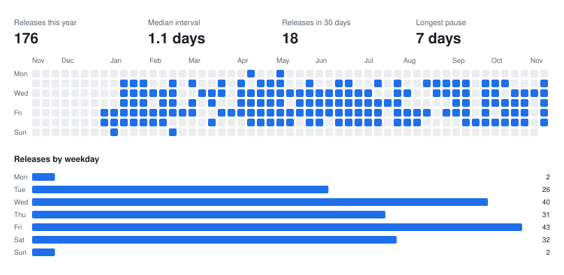

# Wildberries SDK

Wildberries seller API clients for Python, Node.js, Go, PHP and Rust. The clients are generated from the official OpenAPI specs and released again after every spec change.

🌐 [Русский](../../README.md) · **English** · [简体中文](README.zh-CN.md) · [Türkçe](README.tr.md) · [Қазақша](README.kk.md) · [Oʻzbekcha](README.uz.md)

- Documentation: <https://eslazarev.github.io/wildberries-sdk/>, a reference for every Wildberries API operation with examples in five languages.
- API changes on Telegram: [@wildberries_api_radar](https://t.me/wildberries_api_radar), a post for every Wildberries spec update: new methods, rate limits, removals (in Russian).

[](https://deepwiki.com/eslazarev/wildberries-sdk)


| Language | Version | Downloads | README | Registry |
| --- | --- | --- | --- | --- |
| Python | [](https://pypi.org/project/wildberries-sdk/) | [](https://pepy.tech/project/wildberries-sdk) | [docs/python/README.md](../python/README.md) | [pypi.org](https://pypi.org/project/wildberries-sdk/) |
| Node.js | [](https://www.npmjs.com/package/wildberries-sdk) | [](https://www.npmjs.com/package/wildberries-sdk) | [docs/npm/README.md](../npm/README.md) | [npmjs.com](https://www.npmjs.com/package/wildberries-sdk) |
| PHP | [](https://packagist.org/packages/eslazarev/wildberries-sdk) | [](https://packagist.org/packages/eslazarev/wildberries-sdk) | [docs/php/README.md](../php/README.md) | [packagist.org](https://packagist.org/packages/eslazarev/wildberries-sdk) |
| Go | [](https://github.com/eslazarev/wildberries-sdk/tags) | — | [docs/go/README.md](../go/README.md) | [pkg.go.dev](https://pkg.go.dev/github.com/eslazarev/wildberries-sdk/clients/go/finances) |
| Rust | [](https://github.com/eslazarev/wildberries-sdk/tags) | — | [docs/rust/README.md](../rust/README.md) | [crates.io](https://crates.io/crates/wildberries_sdk_finances) |

## Contents

- [Installation](#installation)
- [Features](#features)
- [For AI agents](#for-ai-agents)
- [Updates and releases](#updates-and-releases)
- [Security](#security)
- [API methods](#api-methods)

## Installation

```bash
pip install wildberries-sdk                                      # Python
npm install wildberries-sdk                                      # Node.js
composer require eslazarev/wildberries-sdk                       # PHP
go get github.com/eslazarev/wildberries-sdk/clients/go/finances  # Go, one module per API section
cargo add wildberries_sdk_finances                               # Rust, one crate per API section
```

Each README in the table above has call examples for its language.

## Features

- Full request/response typing. Each client uses the language's native type system: pydantic in Python, TypeScript interfaces in Node.js, Go structs, typed PHP classes, serde structs in Rust. Field typos and wrong types are caught at compile/lint time.
- IDE autocomplete out of the box. Method names, parameters, model fields and enum values are highlighted and suggested — no need to read the Wildberries documentation while writing code.
- Descriptions and docstrings from the specs. Wildberries field- and method-level comments are carried over into the generated code and surface as IDE hover tooltips.
- Client-side validation. Required fields and types are checked before the request leaves your process. In Python, pydantic additionally validates formats, enums and min/max constraints; in Go, TypeScript, PHP and Rust the check is limited to required fields and types.
- One contract across languages. Operation IDs, model fields and endpoints are identical in Python, Node.js, Go, PHP and Rust — migrating between stacks does not require rewriting business logic.
- Batteries-included transport layer. Authentication, headers, base URLs, JSON serialization and HTTP error handling are implemented once in the shared `api_client` / `runtime` / `client` module and reused by every method.

## For AI agents

Install the Claude Code skill with a single command:

```
/plugin install wildberries-sdk --marketplace eslazarev/wildberries-sdk
```

The agent then finds the right operation among ~350 of them, picks the module, the token category and the host, and writes a call that actually runs. Agents outside Claude Code can read [AGENTS.md](../../AGENTS.md) in the repository root and the machine-readable operation index: [llms.txt](https://eslazarev.github.io/wildberries-sdk/llms.txt), [llms-full.txt](https://eslazarev.github.io/wildberries-sdk/llms-full.txt).

The MCP server gives an agent direct access to the API: the agent finds an operation, reads its parameters and calls it with your token. In Claude Code:

```
claude mcp add wildberries --env WB_API_TOKEN=<token> -- uvx wildberries-mcp
```

Setup for Cursor, Claude Desktop and other clients: [mcp-server/README.md](../../mcp-server/README.md).

## Updates and releases

Wildberries changes its API specs several times a week. After each change, GitHub Actions generates the clients again, publishes new versions to PyPI, npm, Packagist and crates.io, and tags a release for Go. New methods and models reach the SDK on the same day, so you do not need to track the changes yourself. The change history is in [CHANGELOG.md](../../CHANGELOG.md), and the release calendar is [on the documentation site](https://eslazarev.github.io/wildberries-sdk/releases/).

<picture>
  <source media="(prefers-color-scheme: dark)" srcset="../../.github/images/release-cadence-en-dark.svg">
  <source media="(prefers-color-scheme: light)" srcset="../../.github/images/release-cadence-en-light.svg">
  
</picture>

## Security

The repository runs these checks:

- CodeQL static analysis
- OpenSSF Scorecard
- TruffleHog verified secret scanning
- Python dependency audit (pip-audit)
- npm audit
- Composer audit
- Cargo audit
- Go vulnerability scanning (govulncheck)
- No hardcoded API tokens in the published packages

[](https://github.com/eslazarev/wildberries-sdk/actions/workflows/codeql.yml)
[](https://github.com/eslazarev/wildberries-sdk/actions/workflows/scorecard.yml)
[](https://github.com/eslazarev/wildberries-sdk/actions/workflows/secrets.yml)
[](https://github.com/eslazarev/wildberries-sdk/actions/workflows/dependency-audit.yml)

## API methods

The SDK covers every published Wildberries spec:

- General — [`specs/01-general.yaml`](../../specs/01-general.yaml)
- Products — [`specs/02-items.yaml`](../../specs/02-items.yaml)
- FBS orders — [`specs/03-orders-fbs.yaml`](../../specs/03-orders-fbs.yaml)
- DBW orders — [`specs/04-orders-dbw.yaml`](../../specs/04-orders-dbw.yaml)
- DBS orders — [`specs/05-dbs.yaml`](../../specs/05-dbs.yaml)
- In-store pickup orders — [`specs/06-in-store-pickup.yaml`](../../specs/06-in-store-pickup.yaml)
- FBW supplies — [`specs/07-orders-fbw.yaml`](../../specs/07-orders-fbw.yaml)
- Marketing and promotion — [`specs/08-promotion.yaml`](../../specs/08-promotion.yaml)
- Buyer communications — [`specs/09-communications.yaml`](../../specs/09-communications.yaml)
- Tariffs — [`specs/10-rates.yaml`](../../specs/10-rates.yaml)
- Analytics — [`specs/11-analytics.yaml`](../../specs/11-analytics.yaml)
- Reports — [`specs/12-reports.yaml`](../../specs/12-reports.yaml)
- Finances and accounting — [`specs/13-finances.yaml`](../../specs/13-finances.yaml)

The full list of methods, with descriptions in Russian taken from the specs, is in the [Russian README](../../README.md#методы-api).
