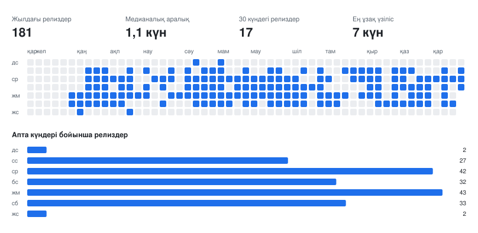

# Wildberries SDK

Wildberries сатушы API-іне арналған Python, Node.js, Go, PHP және Rust клиенттері. Клиенттер ресми OpenAPI спецификацияларынан құрастырылады және спецификация әр өзгерген сайын қайта шығарылады.

🌐 [Русский](../../README.md) · [English](README.en.md) · [简体中文](README.zh-CN.md) · [Türkçe](README.tr.md) · **Қазақша** · [Oʻzbekcha](README.uz.md)

- Құжаттама: <https://eslazarev.github.io/wildberries-sdk/>, барлық Wildberries API операциялары бойынша бес тілдегі мысалдарымен анықтамалық.
- API өзгерістері Telegram-да: [@wildberries_api_radar](https://t.me/wildberries_api_radar), Wildberries спецификацияларының әр жаңартуы туралы пост: жаңа әдістер, лимиттер, жойылғандар (орыс тілінде).

[](https://deepwiki.com/eslazarev/wildberries-sdk)


| Тіл | Нұсқасы | Жүктеулер | README | Реестр |
| --- | --- | --- | --- | --- |
| Python | [](https://pypi.org/project/wildberries-sdk/) | [](https://pepy.tech/project/wildberries-sdk) | [docs/python/README.md](../python/README.md) | [pypi.org](https://pypi.org/project/wildberries-sdk/) |
| Node.js | [](https://www.npmjs.com/package/wildberries-sdk) | [](https://www.npmjs.com/package/wildberries-sdk) | [docs/npm/README.md](../npm/README.md) | [npmjs.com](https://www.npmjs.com/package/wildberries-sdk) |
| PHP | [](https://packagist.org/packages/eslazarev/wildberries-sdk) | [](https://packagist.org/packages/eslazarev/wildberries-sdk) | [docs/php/README.md](../php/README.md) | [packagist.org](https://packagist.org/packages/eslazarev/wildberries-sdk) |
| Go | [](https://github.com/eslazarev/wildberries-sdk/tags) | — | [docs/go/README.md](../go/README.md) | [pkg.go.dev](https://pkg.go.dev/github.com/eslazarev/wildberries-sdk/clients/go/finances) |
| Rust | [](https://github.com/eslazarev/wildberries-sdk/tags) | — | [docs/rust/README.md](../rust/README.md) | [crates.io](https://crates.io/crates/wildberries_sdk_finances) |

## Мазмұны

- [Орнату](#орнату)
- [Мүмкіндіктер](#мүмкіндіктер)
- [ЖИ агенттері үшін](#жи-агенттері-үшін)
- [Жаңартулар мен релиздер](#жаңартулар-мен-релиздер)
- [Қауіпсіздік](#қауіпсіздік)
- [API әдістері](#api-әдістері)

## Орнату

```bash
pip install wildberries-sdk                                      # Python
npm install wildberries-sdk                                      # Node.js
composer require eslazarev/wildberries-sdk                       # PHP
go get github.com/eslazarev/wildberries-sdk/clients/go/finances  # Go, API бөлімі үшін жеке модуль
cargo add wildberries_sdk_finances                               # Rust, API бөлімі үшін жеке crate
```

Жоғарыдағы кестедегі README файлдарында әр тілге арналған шақыру мысалдары бар.

## Мүмкіндіктер

- Сұраныс/жауаптың толық типтелуі. Әр тілдегі клиент өзінің табиғи типтер жүйесін пайдаланады: Python-да pydantic, Node.js-те TypeScript интерфейстері, Go-да struct, PHP-де типтелген кластар, Rust-та serde құрылымдары. Өріс атауларындағы қателер мен қате типтер компиляция/линт кезеңінде ұсталады.
- IDE-да автотолықтыру дайын. Метод атаулары, параметрлер, модель өрістері мен enum мәндері белгіленіп, ұсынылады — Wildberries құжаттамасын оқудың қажеті жоқ.
- Спецификациядан сипаттамалар мен docstring-тер. Wildberries-тің YAML-дағы өріс/метод түсініктемелері кодқа көшіріледі және IDE-да hover-да көрінеді.
- Клиент жағында тексеру. Міндетті өрістер мен типтер сұраныс жіберілмей тұрып тексеріледі (Python pydantic форматтарды, enum-дарды және min/max шектеулерін де тексереді; Go/TypeScript/PHP/Rust-та тексеру міндетті өрістер мен типтермен шектеледі).
- Барлық тілдер үшін бірдей контракт. Операция ID-лері, модель өрістері және эндпоинттер Python, Node.js, Go, PHP және Rust-та бірдей — стектер арасында көшу кезінде бизнес-логиканы қайта жазудың қажеті жоқ.
- Дайын transport-қабат. Аутентификация, тақырыптар, базалық URL-дер, JSON сериализациясы, HTTP қателерін өңдеу — ортақ `api_client` / `runtime` / `client` модулінде бір рет іске асырылған және барлық методтармен қолданылады.

## ЖИ агенттері үшін

Claude Code дағдысы бір командамен орнатылады:

```
/plugin install wildberries-sdk --marketplace eslazarev/wildberries-sdk
```

Орнатқаннан кейін агент ~350 операцияның ішінен керегін өзі табады, модульді, токен санатын және хостты таңдайды және шынымен жұмыс істейтін шақыру жазады. Claude Code-тан тыс агенттерге репозиторий түбіндегі [AGENTS.md](../../AGENTS.md) және операциялардың машинамен оқылатын тізімі керек: [llms.txt](https://eslazarev.github.io/wildberries-sdk/llms.txt), [llms-full.txt](https://eslazarev.github.io/wildberries-sdk/llms-full.txt).

MCP-сервер агентке API-ға тікелей қол жеткізу береді: агент операцияны табады, оның параметрлерін оқиды және сіздің токеніңізбен шақырады. Claude Code-та:

```
claude mcp add wildberries --env WB_API_TOKEN=<токен> -- uvx wildberries-mcp
```

Cursor, Claude Desktop және басқа клиенттерге баптау: [mcp-server/README.md](../../mcp-server/README.md).

## Жаңартулар мен релиздер

Wildberries API спецификацияларын аптасына бірнеше рет өзгертеді. Әр өзгерістен кейін GitHub Actions клиенттерді қайта құрастырады, жаңа нұсқаларды PyPI, npm, Packagist және crates.io-ға жариялайды және Go үшін тег қояды. Жаңа әдістер мен модельдер SDK-ға сол күні түседі, сондықтан өзгерістерді қолмен қадағалаудың қажеті жоқ. Өзгерістер тарихы [CHANGELOG.md](../../CHANGELOG.md) файлында, релиздер күнтізбесі [құжаттама сайтында](https://eslazarev.github.io/wildberries-sdk/releases/).

<picture>
  <source media="(prefers-color-scheme: dark)" srcset="../../.github/images/release-cadence-kk-dark.svg">
  <source media="(prefers-color-scheme: light)" srcset="../../.github/images/release-cadence-kk-light.svg">
  
</picture>

## Қауіпсіздік

Репозиторийде мына тексерулер жұмыс істейді:

- CodeQL статикалық код талдауы
- OpenSSF Scorecard бағалауы
- TruffleHog расталған құпиялар сканерленуі
- Python тәуелділіктер аудиті (pip-audit)
- npm audit
- Composer audit
- Cargo audit
- Go осалдықтарын тексеру (govulncheck)
- Жарияланған пакеттерде қатты кодталған API токендері жоқ

[](https://github.com/eslazarev/wildberries-sdk/actions/workflows/codeql.yml)
[](https://github.com/eslazarev/wildberries-sdk/actions/workflows/scorecard.yml)
[](https://github.com/eslazarev/wildberries-sdk/actions/workflows/secrets.yml)
[](https://github.com/eslazarev/wildberries-sdk/actions/workflows/dependency-audit.yml)

## API әдістері

SDK Wildberries жариялаған барлық спецификацияларды қамтиды:

- Жалпы — [`specs/01-general.yaml`](../../specs/01-general.yaml)
- Тауарлармен жұмыс — [`specs/02-items.yaml`](../../specs/02-items.yaml)
- FBS тапсырыстары — [`specs/03-orders-fbs.yaml`](../../specs/03-orders-fbs.yaml)
- DBW тапсырыстары — [`specs/04-orders-dbw.yaml`](../../specs/04-orders-dbw.yaml)
- DBS тапсырыстары — [`specs/05-dbs.yaml`](../../specs/05-dbs.yaml)
- Дүкеннен алу — [`specs/06-in-store-pickup.yaml`](../../specs/06-in-store-pickup.yaml)
- FBW жеткізілімдері — [`specs/07-orders-fbw.yaml`](../../specs/07-orders-fbw.yaml)
- Маркетинг және жарнама — [`specs/08-promotion.yaml`](../../specs/08-promotion.yaml)
- Сатып алушылармен байланыс — [`specs/09-communications.yaml`](../../specs/09-communications.yaml)
- Тарифтер — [`specs/10-rates.yaml`](../../specs/10-rates.yaml)
- Аналитика — [`specs/11-analytics.yaml`](../../specs/11-analytics.yaml)
- Есептер — [`specs/12-reports.yaml`](../../specs/12-reports.yaml)
- Қаржы және бухгалтерия — [`specs/13-finances.yaml`](../../specs/13-finances.yaml)

Әдістердің толық тізімі (сипаттамалар спецификациялардан орыс тілінде алынған) [орысша README](../../README.md#методы-api) файлында.
