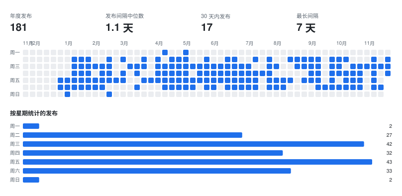

# Wildberries SDK

Wildberries 卖家 API 的 Python、Node.js、Go、PHP 和 Rust 客户端。客户端由官方 OpenAPI 规范生成，每次规范变更后都会重新发布。

🌐 [Русский](../../README.md) · [English](README.en.md) · **简体中文** · [Türkçe](README.tr.md) · [Қазақша](README.kk.md) · [Oʻzbekcha](README.uz.md)

- 文档：<https://eslazarev.github.io/wildberries-sdk/>，涵盖所有 Wildberries API 操作的参考手册，附五种语言的示例。
- Telegram 频道：[@wildberries_api_radar](https://t.me/wildberries_api_radar)，每次 Wildberries 规范更新都会发帖：新方法、速率限制、删除内容（俄语）。

[](https://deepwiki.com/eslazarev/wildberries-sdk)


| 语言 | 版本 | 下载量 | README | 注册表 |
| --- | --- | --- | --- | --- |
| Python | [](https://pypi.org/project/wildberries-sdk/) | [](https://pepy.tech/project/wildberries-sdk) | [docs/python/README.md](../python/README.md) | [pypi.org](https://pypi.org/project/wildberries-sdk/) |
| Node.js | [](https://www.npmjs.com/package/wildberries-sdk) | [](https://www.npmjs.com/package/wildberries-sdk) | [docs/npm/README.md](../npm/README.md) | [npmjs.com](https://www.npmjs.com/package/wildberries-sdk) |
| PHP | [](https://packagist.org/packages/eslazarev/wildberries-sdk) | [](https://packagist.org/packages/eslazarev/wildberries-sdk) | [docs/php/README.md](../php/README.md) | [packagist.org](https://packagist.org/packages/eslazarev/wildberries-sdk) |
| Go | [](https://github.com/eslazarev/wildberries-sdk/tags) | — | [docs/go/README.md](../go/README.md) | [pkg.go.dev](https://pkg.go.dev/github.com/eslazarev/wildberries-sdk/clients/go/finances) |
| Rust | [](https://github.com/eslazarev/wildberries-sdk/tags) | — | [docs/rust/README.md](../rust/README.md) | [crates.io](https://crates.io/crates/wildberries_sdk_finances) |

## 目录

- [安装](#安装)
- [功能](#功能)
- [面向 AI 智能体](#面向-ai-智能体)
- [更新与发布](#更新与发布)
- [安全](#安全)
- [API 方法](#api-方法)

## 安装

```bash
pip install wildberries-sdk                                      # Python
npm install wildberries-sdk                                      # Node.js
composer require eslazarev/wildberries-sdk                       # PHP
go get github.com/eslazarev/wildberries-sdk/clients/go/finances  # Go，每个 API 分区一个模块
cargo add wildberries_sdk_finances                               # Rust，每个 API 分区一个 crate
```

上表中各语言的 README 提供调用示例。

## 功能

- 完整的请求/响应类型。每种语言客户端使用其原生类型系统:Python 的 pydantic、Node.js 的 TypeScript 接口、Go 的 struct、PHP 的强类型类、Rust 的 serde 结构体。字段拼写错误和类型错误在编译/lint 阶段就会暴露。
- IDE 自动补全开箱即用。方法名、参数、模型字段和枚举值都会被高亮和提示,无需查阅 Wildberries 文档。
- 规范中的描述和 docstring 自动同步。Wildberries 在 YAML 中对字段和方法的俄文说明被搬入生成的代码,在 IDE 中悬停可见。
- 客户端校验。必填字段和类型在请求发出前就会被检查(Python 的 pydantic 还会校验格式、枚举和 min/max 约束;Go、TypeScript、PHP、Rust 仅校验必填字段和类型)。
- 跨语言统一契约。操作 ID、模型字段和端点在 Python、Node.js、Go、PHP 和 Rust 之间完全一致 — 跨技术栈迁移不需要改写业务逻辑。
- 开箱即用的传输层。认证、HTTP 头、base URL、JSON 序列化和 HTTP 错误处理在共享的 `api_client` / `runtime` / `client` 模块中实现一次,所有方法复用。

## 面向 AI 智能体

一条命令即可安装 Claude Code 技能：

```
/plugin install wildberries-sdk --marketplace eslazarev/wildberries-sdk
```

安装后，智能体会在约 350 个操作中找到所需的那一个，选对模块、令牌类别和主机，并写出真正可运行的调用。不使用 Claude Code 的智能体可以参考仓库根目录的 [AGENTS.md](../../AGENTS.md) 以及机器可读的操作索引：[llms.txt](https://eslazarev.github.io/wildberries-sdk/llms.txt)、[llms-full.txt](https://eslazarev.github.io/wildberries-sdk/llms-full.txt)。

MCP 服务器让智能体直接访问 API：智能体查找操作、读取参数，并用你的令牌调用。在 Claude Code 中：

```
claude mcp add wildberries --env WB_API_TOKEN=<token> -- uvx wildberries-mcp
```

Cursor、Claude Desktop 等客户端的配置见 [mcp-server/README.md](../../mcp-server/README.md)。

## 更新与发布

Wildberries 每周会多次修改 API 规范。每次变更后，GitHub Actions 会重新生成客户端，向 PyPI、npm、Packagist 和 crates.io 发布新版本，并为 Go 打标签。新方法和模型当天就会进入 SDK，无需手动跟踪变更。变更历史见 [CHANGELOG.md](../../CHANGELOG.md)，发布日历见[文档网站](https://eslazarev.github.io/wildberries-sdk/releases/)。

<picture>
  <source media="(prefers-color-scheme: dark)" srcset="../../.github/images/release-cadence-zh-CN-dark.svg">
  <source media="(prefers-color-scheme: light)" srcset="../../.github/images/release-cadence-zh-CN-light.svg">
  
</picture>

## 安全

仓库运行以下检查：

- CodeQL 静态代码分析
- OpenSSF Scorecard 评分
- TruffleHog 已验证密钥扫描
- Python 依赖审计 (pip-audit)
- npm audit
- Composer audit
- Cargo audit
- Go 漏洞扫描 (govulncheck)
- 发布的包中不包含硬编码的 API 令牌

[](https://github.com/eslazarev/wildberries-sdk/actions/workflows/codeql.yml)
[](https://github.com/eslazarev/wildberries-sdk/actions/workflows/scorecard.yml)
[](https://github.com/eslazarev/wildberries-sdk/actions/workflows/secrets.yml)
[](https://github.com/eslazarev/wildberries-sdk/actions/workflows/dependency-audit.yml)

## API 方法

SDK 覆盖 Wildberries 公开的全部规范：

- 通用 — [`specs/01-general.yaml`](../../specs/01-general.yaml)
- 商品管理 — [`specs/02-items.yaml`](../../specs/02-items.yaml)
- FBS 订单 — [`specs/03-orders-fbs.yaml`](../../specs/03-orders-fbs.yaml)
- DBW 订单 — [`specs/04-orders-dbw.yaml`](../../specs/04-orders-dbw.yaml)
- DBS 订单 — [`specs/05-dbs.yaml`](../../specs/05-dbs.yaml)
- 自提订单 — [`specs/06-in-store-pickup.yaml`](../../specs/06-in-store-pickup.yaml)
- FBW 入库 — [`specs/07-orders-fbw.yaml`](../../specs/07-orders-fbw.yaml)
- 营销和推广 — [`specs/08-promotion.yaml`](../../specs/08-promotion.yaml)
- 买家沟通 — [`specs/09-communications.yaml`](../../specs/09-communications.yaml)
- 资费 — [`specs/10-rates.yaml`](../../specs/10-rates.yaml)
- 分析 — [`specs/11-analytics.yaml`](../../specs/11-analytics.yaml)
- 报表 — [`specs/12-reports.yaml`](../../specs/12-reports.yaml)
- 财务和会计 — [`specs/13-finances.yaml`](../../specs/13-finances.yaml)

完整的方法清单（描述为规范中的俄文原文）见[俄文 README](../../README.md#методы-api)。
